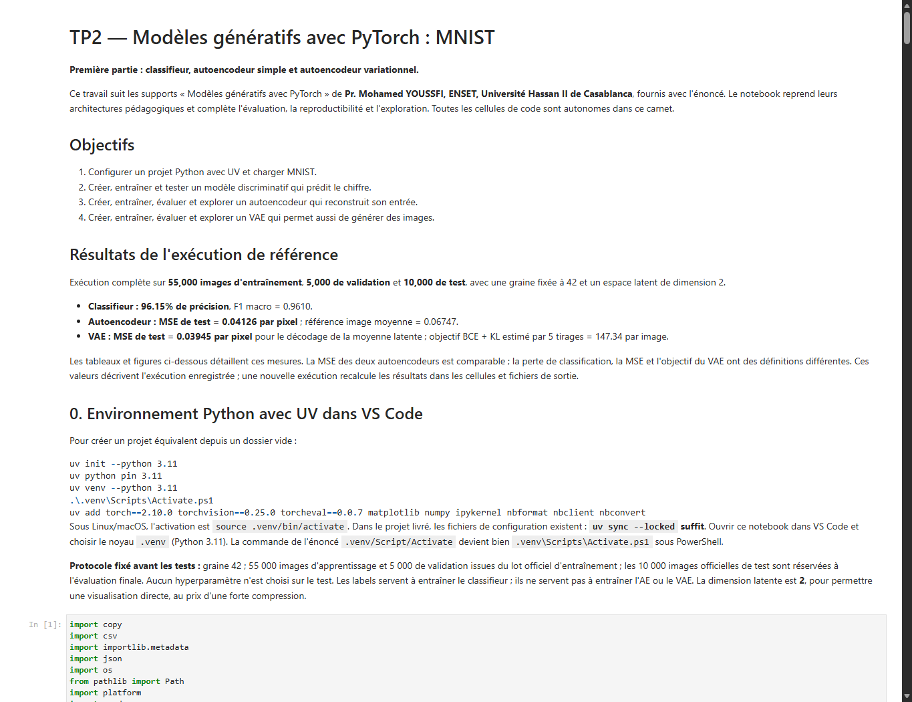
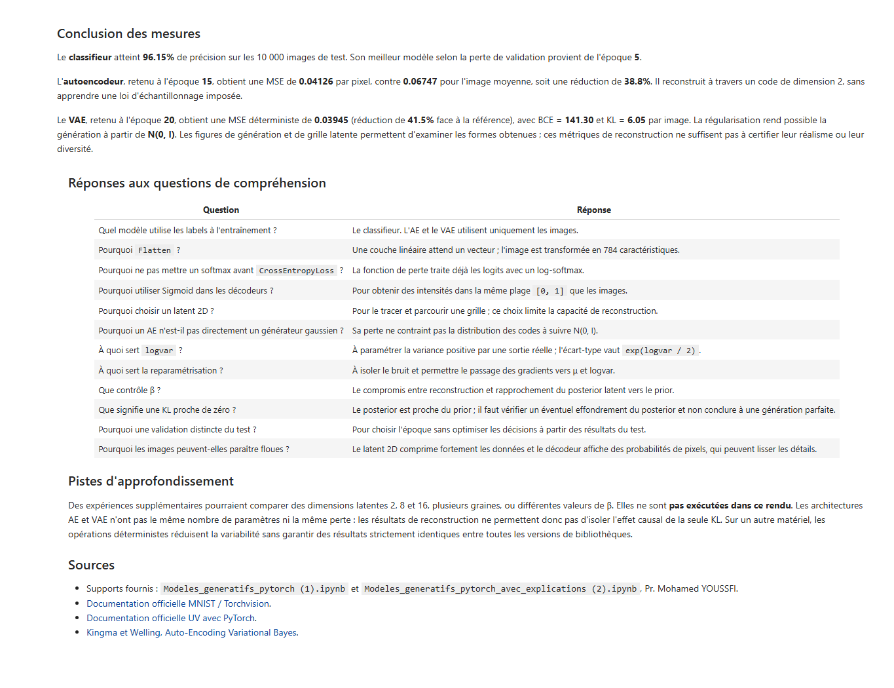

# TP2 — Modèles génératifs avec PyTorch sur MNIST

Créer, entraîner, évaluer et explorer trois réseaux de neurones sur des chiffres manuscrits : un **classifieur**, un **autoencodeur simple (AE)** et un **autoencodeur variationnel (VAE)**.

Le projet traite la **première partie du TP**. Le code, les explications mathématiques et les conclusions sont en français. Le notebook est livré avec ses sorties exécutées : **24 cellules de code exécutées sans erreur et 16 figures enregistrées**.

**[Consulter le notebook complet](TP2_Modeles_generatifs_MNIST.ipynb)** · **[Voir les mesures enregistrées](resultats/metriques.json)** · **[Parcourir les figures](resultats/figures/)**


*De haut en bas : images originales du test, reconstructions de l'AE, puis reconstructions du VAE à partir de la moyenne latente. Les colonnes correspondent aux chiffres de 0 à 9.*

## Objectifs et modèles

| Étape | Objectif | Architecture et apprentissage |
|---|---|---|
| Charger MNIST | Préparer les images et les partitions | Images de 28 × 28 pixels, intensités dans `[0, 1]` |
| Classifieur | Prédire la classe d'une image | `784 → 128 → 10`, ReLU et entropie croisée |
| Autoencodeur | Reconstruire une image à travers un code compressé | Encodeur `784 → 128 → 32 → 2`, décodeur symétrique et MSE |
| VAE | Reconstruire et générer de nouvelles images | Encodeur `784 → 256 → 64`, sorties `μ` et `log σ²` de dimension 2, décodeur `2 → 64 → 256 → 784` |

Le classifieur utilise les étiquettes pendant l'entraînement. L'AE et le VAE apprennent à partir des images ; leurs étiquettes servent ensuite à visualiser les classes dans l'espace latent.

L'AE associe chaque image à un code déterministe. Le VAE apprend une distribution latente et utilise la reparamétrisation `z = μ + exp(log σ² / 2) × ε`, avec `ε ~ N(0, I)`. Sa perte combine une reconstruction par BCE et une divergence KL vers le prior normal, avec **β = 1**. Pour générer une nouvelle image, on tire directement `z ~ N(0, I)` et on le décode.

## Données et protocole

Le lot officiel de 60 000 images d'entraînement de MNIST est séparé de façon reproductible. Le lot officiel de test est conservé pour l'évaluation finale.

| Partition | Nombre d'images | Rôle |
|---|---:|---|
| Apprentissage | 55 000 | Mettre à jour les paramètres |
| Validation | 5 000 | Sélectionner la meilleure époque de chaque modèle |
| Test | 10 000 | Mesurer les performances finales |

Les partitions d'apprentissage et de validation sont disjointes. Toutes les images sont utilisées, sans sous-échantillonnage. La graine est fixée à **42**, la taille des lots à **256** et le taux d'apprentissage d'Adam à **0,001**. La dimension latente de l'AE et du VAE est fixée à **2** pour permettre une exploration dans le plan.


## Résultats de l'exécution

Ces valeurs proviennent de [l'exécution enregistrée](resultats/metriques.json), sous **Python 3.11.18, PyTorch 2.10.0 et Torchvision 0.25.0, sur CPU**. Les meilleures époques ont été sélectionnées sur la validation, avant le calcul des tests.

| Modèle ou référence | Mesure sur les 10 000 images de test | Résultat |
|---|---|---:|
| Classifieur | Précision de classification (accuracy) | **96,15 %** |
| Classifieur | F1 macro | **0,9610** |
| Image moyenne d'apprentissage | MSE par pixel | 0,06747 |
| Autoencodeur | MSE par pixel | **0,04126** |
| VAE, décodage de `μ(x)` | MSE par pixel | **0,03945** |

L'image moyenne sert de référence simple : elle est calculée sur l'apprentissage, puis utilisée pour reconstruire toutes les images de test. Les deux autoencodeurs obtiennent une MSE plus faible que cette référence.

Le VAE obtient également une **BCE de 141,30**, une **KL de 6,05** et un **objectif BCE + KL de 147,34 par image**, estimé avec cinq tirages par image de test. La BCE, la MSE et la perte du classifieur ont des définitions différentes et ne se comparent pas directement.

### Classification : analyser les erreurs


Les lignes indiquent les classes réelles et les colonnes les classes prédites. Les valeurs sur la diagonale correspondent aux prédictions correctes. Les autres cases permettent de repérer les confusions entre chiffres.

Voir aussi les [courbes d'apprentissage et de validation](resultats/figures/02_courbes_classifieur.png) et les [dix premières erreurs du test](resultats/figures/04_erreurs_classifieur.png).

### Reconstruction : comparer les modèles


Les trois mesures utilisent le même jeu de test et la même échelle de pixels. La faible dimension latente entraîne une perte de détails : certaines reconstructions restent ambiguës. Les architectures et les pertes de l'AE et du VAE diffèrent ; cette comparaison ne permet donc pas d'attribuer l'écart de MSE à la seule régularisation KL.

### Génération : produire de nouveaux chiffres avec le VAE


Ces vingt images sont générées sans image d'entrée, à partir de nouveaux vecteurs latents. Tous les tirages sont affichés, sans sélection visuelle. Plusieurs formes sont reconnaissables, mais certaines images restent floues ou ambiguës. Le modèle n'est pas conditionnel : on ne choisit pas directement la classe générée.

### Exploration : parcourir l'espace latent


Chaque case correspond au décodage d'une position `(z₁, z₂)` dans une grille allant de −3 à 3. Les transitions entre les formes rendent visible l'organisation de l'espace latent. Les positions proches des coins sont moins probables sous le prior normal.

Le notebook contient aussi les espaces latents de [l'AE](resultats/figures/07_espace_latent_ae.png) et du [VAE](resultats/figures/12_espace_latent_vae.png), les [prototypes de classes de l'AE](resultats/figures/08_prototypes_ae.png), ainsi que des interpolations pour [l'AE](resultats/figures/09_interpolation_ae.png) et le [VAE](resultats/figures/15_interpolation_vae.png).

**Limites :** la MSE mesure la reconstruction et ne suffit pas à évaluer le réalisme ou la diversité des générations. Les résultats décrivent une exécution avec une graine donnée. Les GAN et les modèles de diffusion présents dans les supports de cours ne font pas partie de cette première partie.

## Installation et exécution

### Prérequis

- [UV](https://docs.astral.sh/uv/getting-started/installation/) pour gérer Python et les dépendances.
- VS Code avec les extensions **Python** et **Jupyter**, pour utiliser le notebook dans l'éditeur.
- Une connexion Internet pour installer les dépendances et télécharger MNIST au premier lancement.

Le projet utilise **Python 3.11**. La version est indiquée dans `.python-version`, les dépendances dans `pyproject.toml` et les versions résolues dans `uv.lock`. L'exécution de référence a fonctionné sur CPU ; CUDA n'est pas nécessaire.

### Exécuter dans VS Code

Cloner ou télécharger le dépôt, ouvrir son dossier dans VS Code, puis exécuter dans le terminal à la racine du projet :

```powershell
uv sync --locked
```

Ouvrir [TP2_Modeles_generatifs_MNIST.ipynb](TP2_Modeles_generatifs_MNIST.ipynb), choisir **Sélectionner le noyau → Environnements Python → .venv**, puis cliquer sur **Tout exécuter**.

L'activation de l'environnement est facultative avec `uv run`. Pour l'activer manuellement sous PowerShell :

```powershell
.\.venv\Scripts\Activate.ps1
```

Sous Linux ou macOS : `source .venv/bin/activate`.

### Exécuter depuis le terminal

```powershell
uv run python scripts/executer_notebook.py
```

Cette commande exécute le carnet de haut en bas et conserve les sorties dans le notebook. Elle recalcule les mesures, les courbes et les figures. Le premier lancement télécharge MNIST dans `data/`.

| Modèle | Nombre d'époques | Meilleure époque de référence |
|---|---:|---:|
| Classifieur | 5 | 5 |
| Autoencodeur | 15 | 15 |
| VAE | 20 | 20 |

L'exécution de référence complète a duré environ **5 minutes sur CPU**. Le temps et les mesures peuvent varier selon le matériel et les versions de l'environnement.

Les paramètres des meilleurs modèles sont enregistrés localement dans `resultats/modeles/`. Ce dossier est ignoré par Git ; une nouvelle exécution les régénère. Une prévisualisation HTML de travail est également créée dans `.qa/`.

## Captures du notebook exécuté

Ces captures proviennent du rendu du carnet après exécution.

<details>
<summary>Voir l'introduction, les objectifs et la synthèse des résultats</summary>



</details>

<details>
<summary>Voir la conclusion et les réponses aux questions de compréhension</summary>



</details>

## Structure du dépôt

```text
.
├── README.md
├── TP2_Modeles_generatifs_MNIST.ipynb   # Carnet principal avec sorties
├── pyproject.toml                     # Configuration du projet UV
├── uv.lock                            # Versions résolues des dépendances
├── .python-version                    # Python 3.11
├── .gitignore
├── docs/
│   └── images/                        # Captures utilisées dans ce README
├── scripts/
│   ├── tp2_source.py                  # Source pédagogique à cellules
│   ├── construire_notebook.py         # Construction du carnet depuis la source
│   └── executer_notebook.py           # Exécution complète et sauvegarde
└── resultats/
    ├── metriques.json                 # Mesures, paramètres et versions
    ├── matrice_confusion.json
    ├── historique_classifieur.csv
    ├── historique_autoencodeur.csv
    ├── historique_vae.csv
    └── figures/                       # Les 16 figures produites
```

Pour modifier la source puis reconstruire le notebook :

```powershell
uv run python scripts/construire_notebook.py
uv run python scripts/executer_notebook.py
```

**La construction efface les anciennes sorties du notebook.** Elle est utile après une modification de `scripts/tp2_source.py` ; elle n'est pas nécessaire pour consulter ou relancer le carnet livré.
