# 🧠 Modèles génératifs avec PyTorch — MNIST

<p align="center">
  
  
  
  
  
</p>

<p align="center">
  <strong>Activité Pratique N°2 — Modèles génératifs</strong><br>
  De la classification à la génération d'images avec les réseaux de neurones PyTorch.
</p>

<p align="center">
  <a href="https://github.com/flamekk/Modeles-generatifs">Voir le dépôt GitHub</a> ·
  <a href="TP2_Modeles_generatifs_MNIST.ipynb">Ouvrir le notebook</a> ·
  <a href="resultats/metriques.json">Consulter les métriques</a>
</p>

---

## 📌 Présentation du projet

Ce projet a été réalisé dans le cadre de l'**Activité Pratique N°2 — Modèles génératifs**, encadrée par **Pr. Mohamed YOUSSFI**. Il met en œuvre PyTorch sur le jeu de données **MNIST** afin de créer, entraîner, tester et explorer trois types de réseaux de neurones :

1. **Un modèle discriminatif** pour reconnaître les chiffres manuscrits de 0 à 9.
2. **Un autoencodeur simple (AE)** pour compresser puis reconstruire les images.
3. **Un autoencodeur variationnel (VAE)** pour apprendre un espace latent probabiliste et générer de nouvelles images.

Le travail suit une démarche expérimentale reproductible : préparation des données, entraînement, sélection sur validation, évaluation sur le jeu de test et exploration visuelle des représentations apprises.

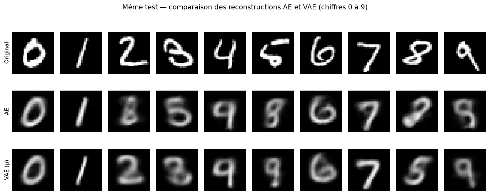

*Comparaison sur des images de test : originales, reconstructions de l'AE et reconstructions du VAE.*

## 🎯 Objectifs pédagogiques

- Configurer un environnement Python avec **UV** dans Visual Studio Code.
- Charger et explorer le dataset MNIST avec Torchvision.
- Construire, entraîner et évaluer un modèle discriminatif.
- Comprendre le fonctionnement d'un autoencodeur et de son espace latent.
- Comprendre le principe du VAE, la reparamétrisation et la divergence KL.
- Générer de nouvelles images à partir de vecteurs latents.
- Comparer les résultats à l'aide de métriques et de visualisations.

## 🗂️ Contenu du projet

| Partie | Travail réalisé | Éléments étudiés |
|---|---|---|
| 0. Environnement | Configuration UV / Python 3.11 | Dépendances, noyau Jupyter, reproductibilité |
| 1. Dataset MNIST | Chargement et préparation | Images 28 × 28, tenseurs, normalisation `[0, 1]` |
| 2. Classifieur | Classification des chiffres | `784 → 128 → 10`, ReLU, Cross Entropy |
| 3. Autoencodeur (AE) | Compression et reconstruction | Encodeur/décodeur, code latent de dimension 2, MSE |
| 4. Autoencodeur variationnel (VAE) | Reconstruction et génération | Moyenne, variance, reparamétrisation, BCE + KL |

### 1. Modèle discriminatif — Classification MNIST

Le classifieur apprend à associer chaque image à l'une des dix classes (0 à 9).

```text
Image MNIST (1 × 28 × 28)
          ↓
        Flatten
          ↓
     Linear(784 → 128)
          ↓
         ReLU
          ↓
     Linear(128 → 10)
          ↓
   Prédiction du chiffre
```

**Éléments clés :** `DataLoader`, `CrossEntropyLoss`, optimiseur Adam, accuracy, F1 macro et matrice de confusion.

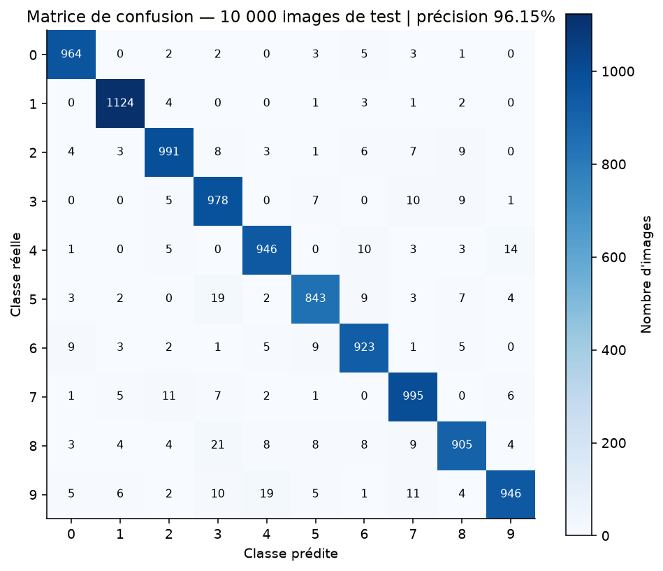

### 2. Autoencodeur simple — AE

L'autoencodeur apprend sans utiliser les étiquettes : il encode une image dans un vecteur latent compact, puis tente de reconstruire l'image d'origine.

```text
Image (784)
    ↓
Encodeur : 784 → 128 → 32 → 2
    ↓
Code latent z (2 dimensions)
    ↓
Décodeur : 2 → 32 → 128 → 784
    ↓
Image reconstruite
```

**Explorations réalisées :** qualité des reconstructions, visualisation de l'espace latent, prototypes par chiffre et interpolation entre deux représentations.

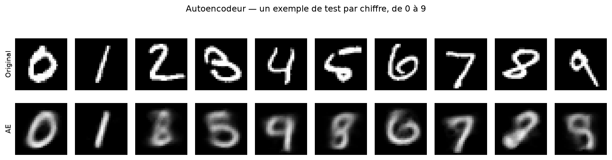

### 3. Autoencodeur variationnel — VAE

Le VAE apprend une distribution dans l'espace latent. Son encodeur estime les paramètres `μ` et `log σ²`, puis l'échantillonnage utilise la reparamétrisation :

`z = μ + exp(0.5 × log σ²) × ε`, avec `ε ~ N(0, I)`.

```text
Image (784)
    ↓
Encodeur : 784 → 256 → 64
    ↓
     μ et log σ²
    ↓
Échantillonnage latent z (2 dimensions)
    ↓
Décodeur : 2 → 64 → 256 → 784
    ↓
Image reconstruite / générée
```

La fonction objectif combine la reconstruction (**BCE**) et la régularisation de l'espace latent (**divergence KL**), avec `β = 1`. De nouvelles images peuvent être générées en échantillonnant `z ~ N(0, I)` puis en utilisant le décodeur.

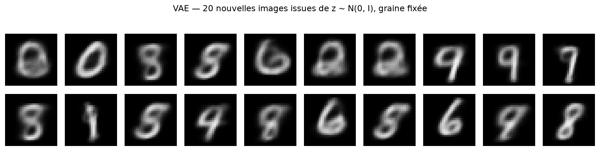

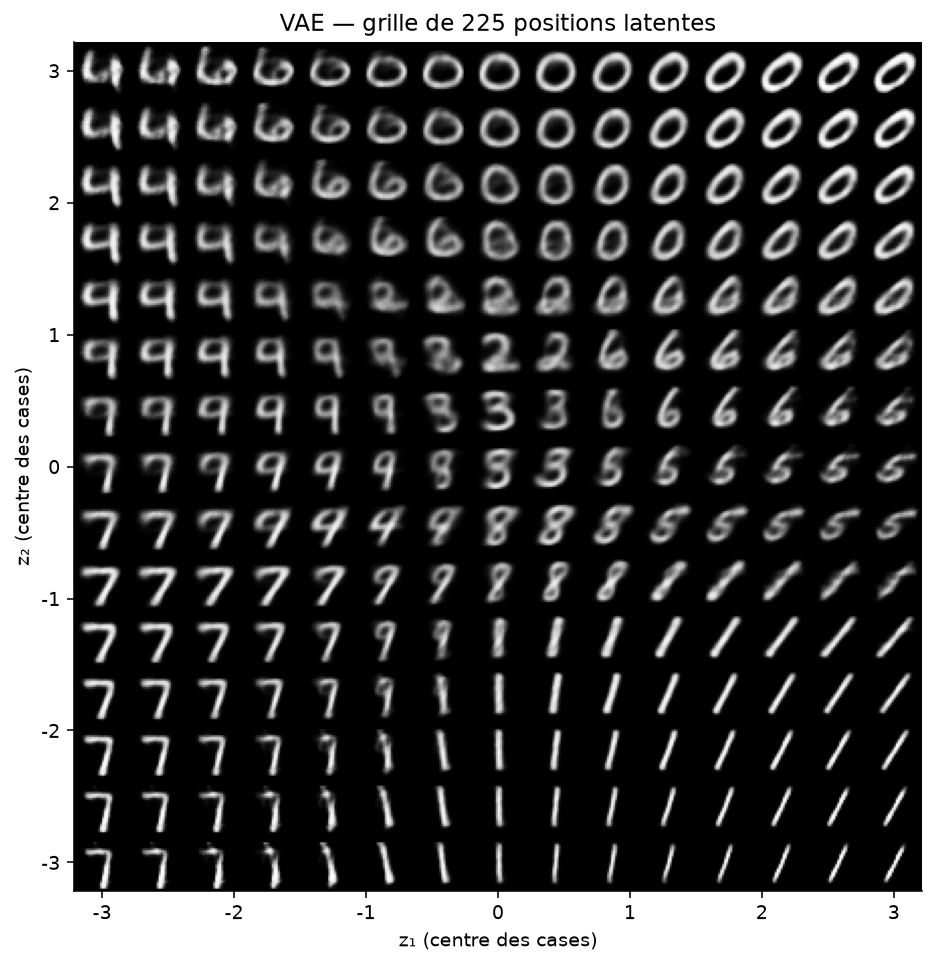

## 📊 Protocole expérimental

Le protocole conserve le jeu de test officiel MNIST pour l'évaluation finale. Les 60 000 images d'entraînement officielles sont divisées en apprentissage et validation.

| Partition | Nombre d'images | Utilisation |
|---|---:|---|
| Apprentissage | 55 000 | Mise à jour des paramètres |
| Validation | 5 000 | Sélection de la meilleure époque |
| Test | 10 000 | Évaluation finale |

**Paramètres communs :** graine aléatoire `42`, batch size `256`, learning rate `0.001`, dimension latente `2`. Les modèles sont entraînés respectivement pendant 5 époques (classifieur), 15 époques (AE) et 20 époques (VAE), avec sélection de la meilleure époque sur validation.

## 📈 Résultats obtenus

Les résultats ci-dessous proviennent de l'exécution enregistrée dans `resultats/metriques.json` (Python 3.11.18, PyTorch 2.10.0, Torchvision 0.25.0, exécution CPU).

| Modèle | Métrique sur le test | Résultat |
|---|---|---:|
| Classifieur | Accuracy | **96,15 %** |
| Classifieur | F1 macro | **0,9610** |
| Image moyenne d'apprentissage (référence) | MSE par pixel | 0,06747 |
| Autoencodeur (AE) | MSE par pixel | **0,04126** |
| VAE (décodage de `μ(x)`) | MSE par pixel | **0,03945** |

Le classifieur atteint une accuracy de 96,15 % sur les 10 000 images de test. Les deux autoencodeurs obtiennent une erreur de reconstruction inférieure à la référence de l'image moyenne. Le VAE permet en plus de générer des images à partir de nouveaux échantillons latents.

> **À noter :** la BCE, la MSE et la perte de classification ne mesurent pas la même chose et ne doivent pas être comparées directement. Une MSE faible ne suffit pas, à elle seule, à juger le réalisme ou la diversité des images générées.

### Galerie des résultats

| Analyse | Visualisation |
|---|---|
| Exemples du dataset MNIST | 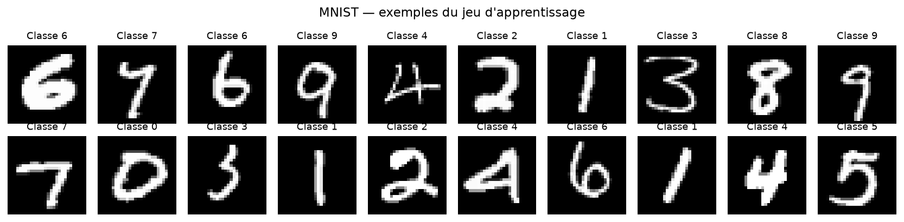 |
| Courbes d'entraînement du classifieur | 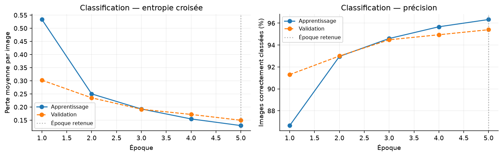 |
| Erreurs de classification | 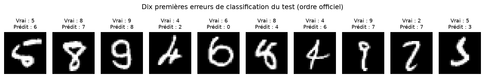 |
| Espace latent de l'AE | 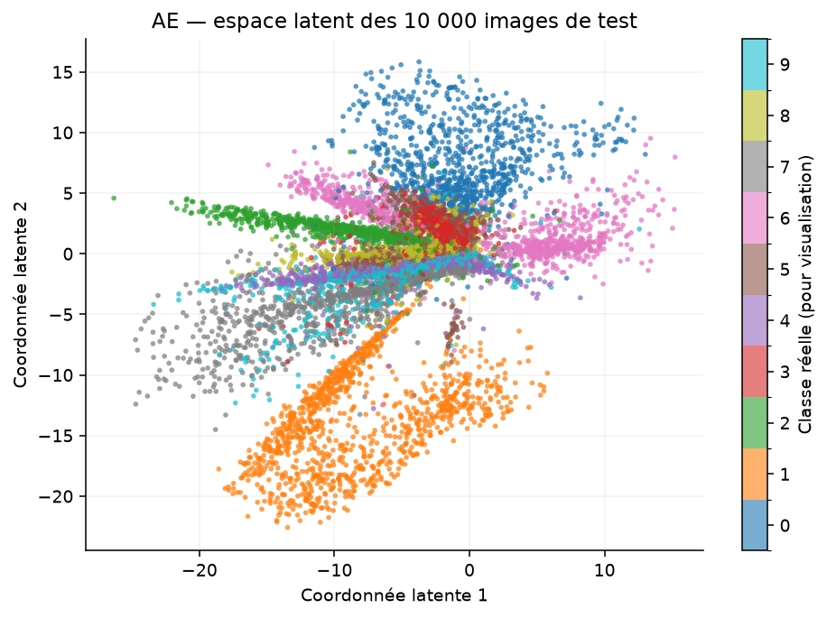 |
| Courbes d'entraînement du VAE | 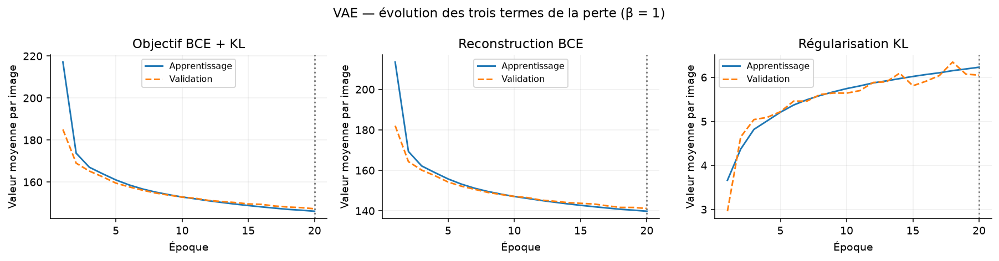 |
| Comparaison des erreurs de reconstruction | 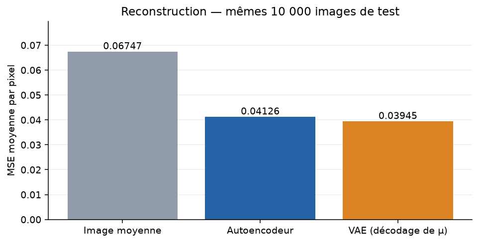 |

Le dossier [`resultats/figures/`](resultats/figures/) contient les 16 figures produites. Les historiques d'entraînement et les métriques détaillées sont également fournis.

## 🛠️ Technologies utilisées

- **Python 3.11** — langage principal.
- **PyTorch 2.10.0** — création et entraînement des réseaux de neurones.
- **Torchvision 0.25.0** — accès au dataset MNIST.
- **Torcheval 0.0.7** — évaluation des modèles.
- **NumPy** — calcul numérique.
- **Matplotlib** — visualisation des données et résultats.
- **UV** — gestion de l'environnement et des dépendances.
- **VS Code & Jupyter** — développement et exécution du notebook.
- **Git & GitHub** — gestion de versions et partage du projet.

## ⚙️ Installation et exécution

### Prérequis

- Python 3.11.
- [UV](https://docs.astral.sh/uv/getting-started/installation/) installé.
- Visual Studio Code avec les extensions **Python** et **Jupyter**.
- Une connexion Internet au premier lancement pour télécharger MNIST.

### 1. Cloner le dépôt

```bash
git clone https://github.com/flamekk/Modeles-generatifs.git
cd Modeles-generatifs
```

### 2. Installer l'environnement et les dépendances

```bash
uv sync --locked
```

Cette commande crée l'environnement `.venv` et installe les versions définies dans `uv.lock`.

### 3. Ouvrir le notebook

Ouvrir `TP2_Modeles_generatifs_MNIST.ipynb` dans VS Code, sélectionner le noyau Python de `.venv`, puis exécuter les cellules.

### 4. Exécuter depuis le terminal (optionnel)

```bash
uv run python scripts/executer_notebook.py
```

Pour reconstruire le notebook à partir de sa source pédagogique avant exécution :

```bash
uv run python scripts/construire_notebook.py
uv run python scripts/executer_notebook.py
```

**Attention :** la reconstruction du notebook efface ses sorties précédentes ; elle est utile après une modification de `scripts/tp2_source.py`.

## 📁 Structure du dépôt

```text
Modeles-generatifs/
├── README.md
├── .python-version
├── pyproject.toml
├── uv.lock
├── .gitignore
├── TP2_Modeles_generatifs_MNIST.ipynb
├── docs/
│   └── images/                    # Captures du notebook
├── scripts/
│   ├── tp2_source.py              # Source pédagogique
│   ├── construire_notebook.py    # Génération du notebook
│   └── executer_notebook.py      # Exécution complète
└── resultats/
    ├── metriques.json             # Résultats détaillés
    ├── matrice_confusion.json
    ├── historique_*.csv           # Historiques d'entraînement
    └── figures/                    # 16 visualisations
```

Les données téléchargées, l'environnement virtuel, les fichiers temporaires et les poids des modèles entraînés localement sont exclus du suivi Git via `.gitignore`.

## 🎓 Compétences développées

- Préparation et exploration d'un dataset d'images.
- Construction et entraînement de réseaux de neurones avec PyTorch.
- Classification supervisée et évaluation multi-classes.
- Compression, reconstruction et représentation dans un espace latent.
- Compréhension du VAE, de la reparamétrisation et de la divergence KL.
- Génération d'images par échantillonnage latent.
- Analyse des performances et interprétation de visualisations.
- Gestion d'un environnement reproductible avec UV et Git.

## 👩‍💻 Auteur

**Hiba Zbari**  
Étudiante ingénieure — Big Data & Intelligence Artificielle  
Activité Pratique N°2 — Modèles génératifs avec PyTorch  
Encadrement : **Pr. Mohamed YOUSSFI**

---

<p align="center">
  <strong>Built with Python, PyTorch & curiosity for Generative AI ✨</strong><br>
  <a href="https://github.com/flamekk/Modeles-generatifs">github.com/flamekk/Modeles-generatifs</a>
</p>
